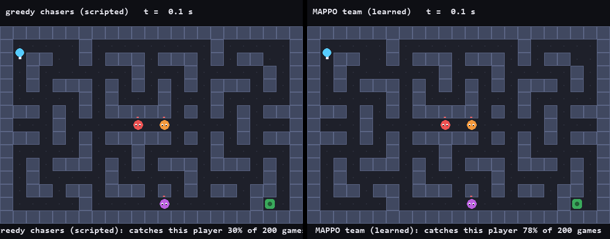
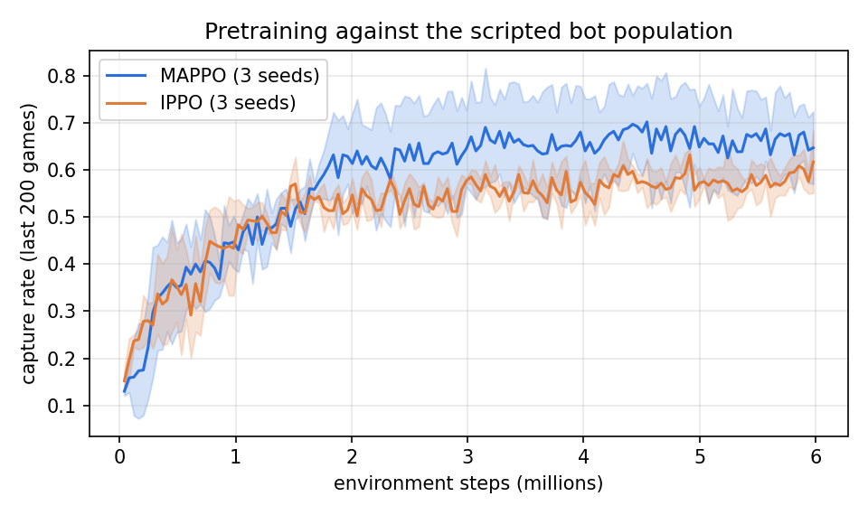
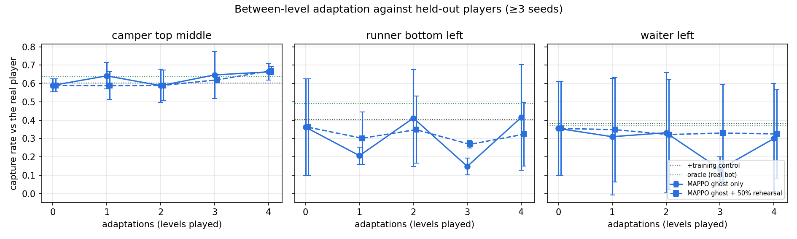
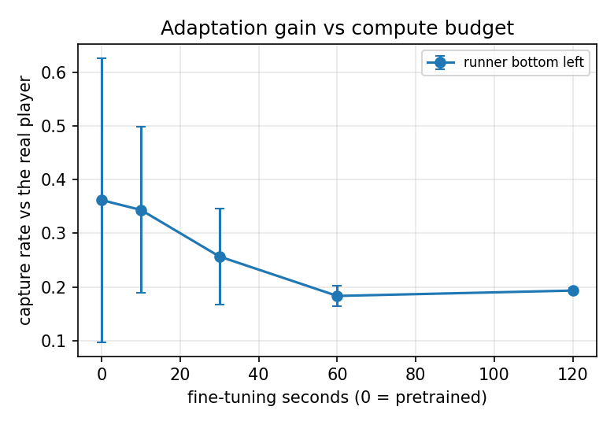

# MazeHunt: Monsters That Learn How You Play

**Rapid between-level adaptation of cooperative multi-agent pursuers to individual players.**

A 2D top-down maze shooter used as a testbed for multi-agent reinforcement learning (MARL). A team of RL-controlled monsters hunts the player. After every level, the monsters retrain against a learned copy of how *you* play, so on the next level they cut off your favorite escape routes, flank you, and anticipate your habits.

Underneath the game is **pursuit-evasion**, a classic multi-robot problem (security robots, drone interception, search-and-rescue). The game is the testbed; the learning method is the contribution.



*Same held-out player bot, same map. Left: scripted greedy chasers all follow the player and it escapes. Right: a MAPPO team (seed 1) keeps one monster near the exit corridor and catches it. Captions show capture rates measured over 200 games, not just this clip.*

---

## Quick start

```bash
python -m venv .venv
.venv\Scripts\python -m pip install -r requirements.txt     # Windows; on Linux/macOS use .venv/bin/python
.venv\Scripts\python play.py                                # play against scripted monsters
.venv\Scripts\python play.py --monsters learned --adapt 30  # play the trained team; it studies you between levels
.venv\Scripts\python -m pytest                              # run the tests
```

Everything runs on a laptop CPU (small networks, fast headless rules). No GPU needed.

**Controls:** `WASD` move · `Arrow keys` shoot · `P` pause · `Esc` quit
**Options:** `--monsters greedy|random|learned` (default `greedy`) · `--model results/models/mappo_s0.pt` · `--adapt SECONDS` (fine-tune against your ghost between levels) · `--seed N` · `--no-record`

Each level you play is saved locally to `results/recordings/<session>/level_XX.json` (git-ignored). These recordings are the training data for your ghost.

---

## How it works

RL normally needs millions of practice rounds, and a human player provides a few minutes of data. The monsters therefore **can't learn from scratch in real time**, so learning is split into two phases:

```
 ┌──────────────── OFFLINE ─────────────────────────────────────────┐
 │ 1. PRETRAIN: monsters learn general hunting with MARL (MAPPO)    │
 │    against a population of scripted player bots with different  │
 │    styles: exit runners, campers, kiter, hunter, random          │
 └──────────────────────────────────────────────────────────────────┘
                                │
 ┌──────────────── ONLINE (while a person plays) ───────────────────┐
 │ 2. PLAY level k      → record the player's positions + actions    │
 │ 3. CLONE the player  → train a small "ghost" network that imitates│
 │                        the player (behavior cloning, seconds)     │
 │ 4. ADAPT monsters    → fine-tune monsters against the ghost in a  │
 │                        fast headless sim during a short break     │
 │ 5. PLAY level k+1    → monsters now counter this player's habits  │
 └──────────────────────────────────────────────────────────────────┘
```

- **Same map every level**, so any improvement comes from learning the *player*, not the map.
- **Ghost player:** monsters practice thousands of rounds against a copy of the player in seconds, instead of waiting for the player to play thousands of rounds.

| Game concept | Research concept |
|---|---|
| Monsters cooperating to trap the player | Multi-agent coordination (MARL) |
| Monsters splitting up to cover exits | Macro-scale coordination (team strategy, role allocation) |
| Each monster chasing and dodging bullets | Micro-scale control (individual behavior) |
| Learning *this* player's habits | Opponent modeling / online adaptation |
| Adapting during a short break | Learning under data and compute constraints |

### The pieces

| Piece | File | What it does |
|---|---|---|
| Player bots | [`bots/player_bots.py`](mazehunt/bots/player_bots.py) | 8 training styles (3 exit runners with different favourite routes, 2 campers, kiter, hunter, random) and 3 **held-out** styles never seen in pretraining (a bottom-left runner, a "waiter" who hides until the exit is unguarded, a top-middle camper). Bots react to a lined-up monster with probability 0.35 per tick, roughly human reaction time; pretraining draws it from 0–0.5 per level |
| RL environment | [`env/hunt_env.py`](mazehunt/env/hunt_env.py), [`env/features.py`](mazehunt/env/features.py) | Parallel multi-agent API, one shared team reward (+10 capture, −10 escape or timeout, plus telescoping distance shaping). 40-number observation per monster built from maze (BFS) distances |
| MAPPO / IPPO | [`agents/mappo.py`](mazehunt/agents/mappo.py) | One readable file. Shared actor across monsters; MAPPO adds a centralized critic over all monsters' views, IPPO gives each monster its own critic. Decentralized at play time |
| Ghost player | [`adapt/ghost.py`](mazehunt/adapt/ghost.py) | Behavior cloning: 46-number player view → 9 actions, ~1 s of training on a few hundred recorded ticks |
| Adaptation | [`adapt/pipeline.py`](mazehunt/adapt/pipeline.py) | Recordings → ghost → fine-tune a copy of the team against the ghost for a fixed wall-clock budget |

---

## Results

All numbers are capture rates over 200 games (mean ± std over 3 seeds) against bots at the fixed evaluation reaction of 0.35. Full tables: [`results/summary.md`](results/summary.md). Raw data: `results/*.json`. Technical write-up: [`report/technical_note.md`](report/technical_note.md).

**1. MARL pretraining works, and MAPPO can discover role splitting (RQ3).**



| Team | Training bots | Held-out bots | Monster near exit (% of ticks) | Mean distance between monsters |
|---|---|---|---|---|
| Greedy chasers (scripted) | 0.47 | 0.37 | 0% | 6.3 tiles |
| IPPO | 0.48 ± 0.03 | 0.35 ± 0.03 | 0% | 6.4 tiles |
| MAPPO | **0.55 ± 0.08** | **0.41 ± 0.16** | 14% | 8.9 tiles |

The MAPPO average comes mostly from one seed: MAPPO seed 1 learned a **role split**. One monster holds the single corridor to the exit (43% of ticks) while the others hunt, and the team spreads out to 12 tiles apart. It catches 65% of all players, the best team. No IPPO seed found this. With 3 seeds that's suggestive, not conclusive.

**2. Between-level adaptation helps when the player is easy to clone, and not yet otherwise (RQ1, RQ2).**



| Held-out player | Pretrained | After 4 adaptations | Gain (paired) | "Just train more" control | Oracle (fine-tune on the real bot) |
|---|---|---|---|---|---|
| Camper (holds a spot) | 0.59 ± 0.03 | **0.66 ± 0.05** | **+0.07 ± 0.02** (all 3 seeds) | 0.60 ± 0.07 | 0.64 ± 0.06 |
| Runner (bottom-left route) | 0.36 ± 0.26 | 0.42 ± 0.29 | +0.05 ± 0.09 | 0.40 ± 0.23 | 0.49 ± 0.22 |
| Waiter (hides, then dashes) | 0.35 ± 0.26 | 0.30 ± 0.30 | −0.05 ± 0.06 | 0.38 ± 0.30 | 0.37 ± 0.28 |

- Against the **camper**, every seed improved, and the gain beats extra training on the general bots. The adapted team matches the oracle.
- Against the **mobile players** the ghost-trained team does not beat the control. The oracle *does* improve against the runner (+0.12 to +0.17 on seeds 0 and 2), so fine-tuning itself works. **The bottleneck is the ghost:** cloned from 50–370 ticks of a moving player, it is a poor copy (it escapes far less often than the real bot).
- Keeping 50% of fine-tuning games against the pretraining bots ("rehearsal") made the curves steadier (the waiter's paired-gain spread fell from ±0.06 to ±0.01), but didn't create gains.

**3. More compute against a weak ghost makes things worse (RQ4).**



With one recorded runner level, capture drops from 0.36 (pretrained) to 0.19 after 60–120 s of fine-tuning (up to 700k steps). The team overfits to the ghost's mistakes. This is the clearest evidence that **player-model quality, not compute, limits rapid adaptation here**.

**Behavior cloning on real human play (preliminary).** On 26 levels of the author's own play (444 ticks, recorded under an earlier balance), the ghost predicts the next key with 59% accuracy on held-out sessions, vs 46% for always guessing the most common key.

### What this means and what's next

The pipeline works end to end on a laptop: record, clone, fine-tune, play. It adapts reliably to a stationary style. For mobile players, the open problem is a better player model from very little data. Candidates: data aggregation with the ghost in the loop (DAgger), an ensemble of ghosts with early stopping on held-out recorded ticks, and mixing the ghost with nearby bot styles. Budgets should also be counted in environment steps, not wall-clock seconds: wall-clock budgets varied up to 10× with machine load.

---

## Research questions

| # | Question | Status |
|---|---|---|
| RQ1 | Does between-level adaptation beat a fixed pretrained team? | Yes vs the camper (+7 points, all seeds); not yet vs mobile players |
| RQ2 | How much player data is enough? | More data limits the damage (waiter: 0.12 from 1 level → 0.34 from 3), but neither beats the control for mobile players |
| RQ3 | Do the monsters actually coordinate? | One MAPPO seed learned exit guarding plus hunting; no IPPO seed did |
| RQ4 | How much does the compute budget matter? | With a poor ghost, more budget hurts (overfitting) |

---

## Status

- [x] Game core: headless rules, arena map, renderer, human play with level/lives loop, recording
- [x] Scripted player bots: 8 training styles + 3 held-out styles, human-like reaction
- [x] Multi-agent RL environment, MAPPO / IPPO trainer, 6 trained teams (`results/models/`)
- [x] Ghost player + between-level adaptation, in experiments and in the playable game (`--adapt`)
- [x] Experiments RQ1–RQ4 with 3 seeds, controls and an oracle; figures; demo GIFs; 42 tests
- [ ] Better player model for mobile players (DAgger / ghost ensembles); step-count budgets
- [ ] Human playtests of the adaptive game

---

## Game design

| Element | Design |
|---|---|
| Map | One fixed 23×15 tile maze ([`arena.txt`](mazehunt/maps/arena.txt)) |
| Movement | Tile-based, **discrete actions** (stay, up, down, left, right); smooth animation in rendering only |
| Player | Moves 1 tile/tick; shoots straight-line bullets (2 tiles/tick), 3 ammo with regeneration and a cooldown |
| Monsters | 3 monsters at 75% of player speed; catch the player on contact; die in one hit and respawn after 5 s |
| Level win | Reach the exit, or survive 60 s |
| Level loss | A monster catches the player |

Every balance number lives in [`mazehunt/config.py`](mazehunt/config.py).

**Architecture:** game **rules** (`mazehunt/core`) are headless and deterministic, and fully separate from **rendering** (`mazehunt/render`). The rules run at about 70k steps/s on one CPU core; full RL training (features, bots, networks) runs at about 5k environment steps/s per process.

**One tick** ([`game.py`](mazehunt/core/game.py)): respawns → player moves or fires → bullets fly → monsters move → bullet hits → capture check (same tile *or* swapped tiles) → exit/timeout check.

---

## Reproduce

```bash
bash train/run_all.sh   # pretraining (~50 min) + experiments (~1.5 h on 8 GB RAM) + figures + demo GIFs
```

Or step by step: `train/pretrain.py` → `train/eval_teams.py` (RQ3) → `train/exp_adaptation.py` (RQ1, RQ2) → `train/exp_budget.py` (RQ4) → `train/make_figures.py` → `train/make_demo_gif.py`. Trained teams are in `results/models/`.

---

## Repo structure

```
├── play.py              ← run the game
├── mazehunt/
│   ├── config.py        ← all balance numbers
│   ├── maps/            ← tile maps (# wall, . floor, P player, M monster, E exit)
│   ├── core/            ← headless rules: maze, entities, actions, game
│   ├── bots/            ← scripted player bots (training + held-out styles)
│   ├── env/             ← multi-agent RL environment + observation features
│   ├── agents/          ← monster teams: scripted baselines, MAPPO/IPPO
│   ├── adapt/           ← ghost player (behavior cloning) + between-level adaptation
│   ├── record.py        ← gameplay recording
│   └── render/          ← pygame renderer + playable game loop
├── train/               ← pretraining, experiments, figures, demo GIF
├── tests/               ← rule and learning tests (pytest)
├── results/             ← models, logs, experiment JSON, figures
└── report/              ← technical report
```

---

## Credits

Graphics are drawn with pygame shapes; see [CREDITS.md](CREDITS.md). MAPPO: Yu et al., *The Surprising Effectiveness of PPO in Cooperative Multi-Agent Games* (NeurIPS 2022). IPPO: de Witt et al., *Is Independent Learning All You Need in the StarCraft Multi-Agent Challenge?* (2020). PPO implementation style follows [CleanRL](https://github.com/vwxyzjn/cleanrl).

Author: Joy Barno
